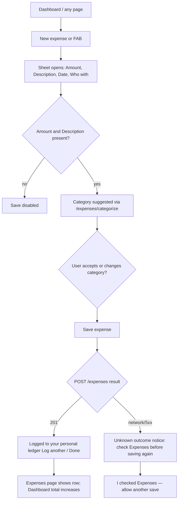
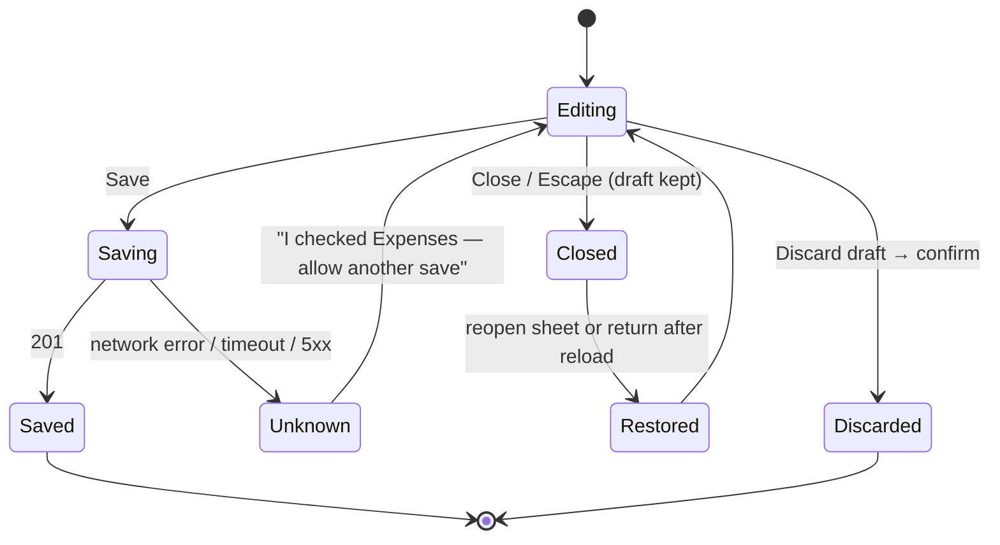
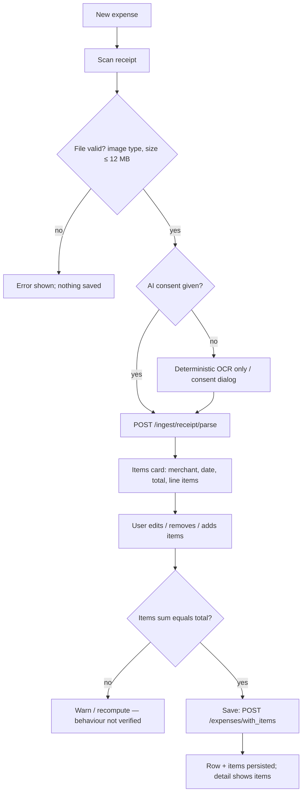
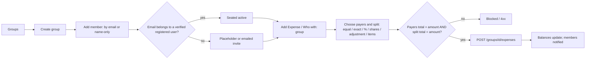
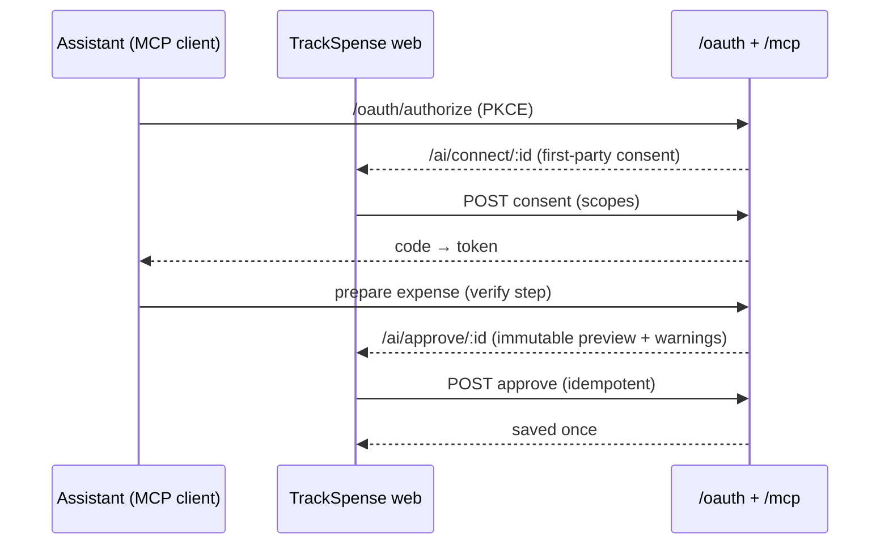

# 03 — User Journeys

Personas: **Solo** (one person tracking their own spending), **Organiser** (creates and runs a shared group), **Member** (invited into a group), **Power user** (cards, budgets, tags), **Assistant user** (connects an external AI assistant). Verification tags follow `01-feature-inventory.md` (R / C / U). Interaction IDs refer to `02-interaction-inventory.md`; test IDs to `04-uat-test-cases.md`.

Each journey states: goal, persona, preconditions, entry, steps, branches, success, alternate/failure/cancel/recovery paths, persistent data changes, interactions, acceptance criteria (AC). Steps marked ✔ were walked at runtime in the audit; others come from code and are **unverified in the running app**.

---

## J-01 — Create an account and reach the dashboard (Solo) · P0
**Goal:** a new user can sign up and see an empty-but-usable app. **Pre:** logged out; email unused. **Entry:** `/` → Create account, or `/register`.
1. Open `/register` ✔ → 2. Enter Name, Email, (Phone), Password (≥ 8, not common) → 3. Create Account → 4. Signed in; dashboard shows Getting-started checklist and verification prompt (C) → 5. (Later) open emailed link → `/verify-email` → "Email verified" (C).
**Branches:** Google sign-up (INT-008). **Failure:** duplicate email → generic error, no enumeration; weak password blocked; server error → inline alert. **Cancel:** navigate away, nothing persists. **Recovery:** unverified users can still log expenses; group seating by email requires a *verified registered* user (✔ API returned 400 "No registered user with that email" for an unverified account).
**Data:** `users` row (+ verification token). **Interactions:** INT-006..008, 011, 044. **AC:** AC-J01-1 account is created exactly once; AC-J01-2 no account-existence leak; AC-J01-3 user lands on `/dashboard` authenticated; AC-J01-4 required-field errors are per field and send no request (qa REG-024).

## J-02 — Sign in, stay signed in, sign out (Solo) · P0
**Pre:** account exists. **Entry:** `/login`, or a guarded URL.
1. Visit `/dashboard` logged out ✔ → redirected `/login` → 2. Submit valid credentials → 3. Land on original destination (`postLoginDestination`) → 4. Reload; session persists (qa AUTH-008) → 5. Account menu → Log out → `/login`; `/dashboard` now redirects (qa AUTH-009).
**Failure:** wrong password → "Incorrect email or password." (`role=alert`, focus to password) ✔; unknown email same message; 429 → wait message; empty → no request ✔; network failure → "Can't reach the server…". **Expiry:** access token expiry → silent refresh; failed refresh → `/login`; transient refresh failure must **not** sign the user out (AGENTS.md; C). **Rapid clicks:** the submit button disables while loading (C).
**Data:** cookies (`vs_token`, `vs_refresh`, `vs_csrf`), refresh family; logout revokes. **AC:** AC-J02-1 same error for wrong password and unknown email; AC-J02-2 protected routes unreachable logged out; AC-J02-3 logout ends the session server-side.

## J-03 — Log a simple personal expense (Solo) · P0 (Journey A)

**Pre:** signed in. **Entry:** header **New expense** (desktop), FAB (phone), checklist, type-to-log bar.
Steps ✔ (desktop and 390px): open sheet → enter Amount 23.45 → Description "Lunch at Zuni" → category chosen automatically (`Dining out`) → Save → success state → Done → `/expenses` shows "Lunch at Zuni $23.45".
**Branches:** "Who was this with?" a group → group expense (J-09); More options → merchant/tags/card; Scan receipt (J-05). **Negative:** missing amount/description → Save disabled ✔; 3rd decimal/ceiling cannot be typed (qa); negative rejected. **Duplicate protection:** double-click produced one `POST /expenses` ✔. **Cancel:** Close with a dirty form keeps a draft (no confirm); reopening restores it ✔ (J-04). **Persistent change:** one `expenses` row; derived insights aggregated in the background; dashboard/analysis views refresh (`refreshExpenseViews`).
**AC:** AC-J03-1 exactly one row with the entered amount/date; AC-J03-2 Dashboard True Total changes by exactly that amount (qa DASH-002); AC-J03-3 the row is findable by search; AC-J03-4 a second identical click does not create a second row.

## J-04 — Recover from a failed save or interruption (Solo) · P0

✔ Observed: simulated aborted POST → "The save outcome is unknown. Check Expenses before saving again to avoid a duplicate." and "Connection lost. Check your records before saving again." (both `role=alert`); after navigation the sheet reopened with "Your unsaved expense was restored. Review it before saving." plus the unknown-outcome notice; Discard asks "Discard this expense? Cancel / Discard". The browser also showed a "Leave site?" prompt during navigation while the draft was dirty.
**Rules (AGENTS.md):** drafts are account-scoped, 1 h TTL, in tab `sessionStorage`/native SecureStore; auth expiry preserves the draft, deliberate logout clears it; never auto-replay a financial write after connection/timeout/5xx.
**AC:** AC-J04-1 no automatic retry of POST; AC-J04-2 draft restored with items/splits intact; AC-J04-3 explicit user confirmation is required before a second save after an unknown outcome.

## J-05 — Scan a receipt and log itemised expense (Solo) · P0 (Journey B) — **runtime-unverified**

**Pre:** signed in; OCR engine available (`OCR_ENGINE`, local `mock`). **Entry:** Quick Capture → Scan receipt (web file/camera picker; mobile: on-device OCR then `/ingest/receipt/parse_ocr`). **Failure:** wrong content type → 415, >12 MB → 413 (qa API), OCR/parse failure → error + manual entry; **Cancel:** close discards parsed data unless a draft is kept (U). **Open product decisions:** behaviour when line items don't sum to the total (D-02); max items; duplicate receipt detection.
**Data:** `expenses` + `expense_items`; entity-resolution suggestions if enabled. **AC:** AC-J05-1 unsupported file never creates an expense; AC-J05-2 saved item totals equal the expense total (or the user is told otherwise); AC-J05-3 extracted fields are editable before save.

## J-06 — Review, edit and delete an expense (Solo) · P0
1. `/expenses` ✔ → 2. open a row ✔ (detail sheet: Description, Merchant, tags, Date, Amount, Notes) → 3. change a field → Save changes (C) → list/dashboard reflect it → 4. Delete expense → "Delete expense? This action cannot be undone." ✔ → Cancel keeps ✔ / Delete removes (C).
**Branches:** Move to group…; add tag; row hover/focus edit/delete icons ✔. **Failure:** 422 shows inline; deleting another user's id → 404 (qa EXP-017). **Data:** `PUT`/`DELETE /expenses/{row_id}`; totals and insights change. **AC:** AC-J06-1 edit persists after reload; AC-J06-2 cancelled delete leaves the row; AC-J06-3 deleted expense disappears from list, dashboard and analysis totals (qa DASH-003, CALC-002).

## J-07 — Find, filter and export expenses (Solo) · P1
Search ✔ (match; no-match empty state "No expenses match this view… Clear filters" ✔) → month filter → tag filter → scope tab (Personal / Groups / Personal + my shares ✔) → Select mode → bulk Tag/Untag (C) → Export CSV (C). **AC:** AC-J07-1 CSV rows equal the visible month filter; AC-J07-2 clearing filters restores the full list; AC-J07-3 special characters in search never crash.

## J-08 — Set up and confirm recurring expenses (Solo) · P1
Expenses → Recurring ✔ (empty state, Add) → fill template (Description, Merchant, Day of month, Monthly amount, Start date, Category) → Save (C) → later, on login, the **due sheet** lists due items (✔ the API call `GET /recurring/due` fires on every page) → edit amount → Confirm / Confirm all / Dismiss (C) → expenses created; views refresh. **Branches:** Run now; delete template (confirm). **Failure:** partial failure → "Failed to add one or more expenses…". **Open:** double "Run now" idempotency (D-04). **AC:** AC-J08-1 each due item creates exactly one expense; AC-J08-2 dismissed items remain due; AC-J08-3 no due items → no sheet.

## J-09 — Create a group and log a shared expense (Organiser) · P0

✔ Walked via API + UI: group "Audit Trip" with a name-only member and a $100 expense appears on dashboard ("Audit Trip · your share"), Groups rail, Expenses → Groups tab; balances at "Settled" when only payer. **Failure:** unmatched email → 400 with guidance ✔; payers/split mismatch → 4xx (qa GRP-006/007). **Non-members:** 404 "Group not found". **Data:** group, members, expense + splits, notifications. **AC:** AC-J09-1 balances sum to zero (qa CALC-006); AC-J09-2 odd-cent splits follow the largest-remainder rule (CALC-005); AC-J09-3 editing without payers/split keeps the stored split.

## J-10 — Settle up a group balance (Organiser / Member) · P0
```mermaid
sequenceDiagram
  participant U as User
  participant UI as Settle dialog
  participant API as /groups/{id}/settlements
  U->>UI: Settle up (group or People row)
  UI->>U: Suggested transfers (simplified) or custom form
  U->>UI: Pick transfer / enter From, To, Amount, Method, Notes
  UI->>API: POST settlement
  API-->>UI: 201
  UI->>U: Done; balances recompute; "all settled up"
```
C only (dialog not exercised). **Branches:** custom settlement; method Cash/Venmo/UPI/Other (payment deep links); delete settlement. **Failure:** amount > owed, from = to, non-member (U); cannot close while settling. **AC:** AC-J10-1 balances equal zero after settling the exact owed amounts; AC-J10-2 recorded settlement is visible in activity; AC-J10-3 per-person "owes you" derives from the viewer's transfers.

## J-11 — Accept a group invite (Member) · P1
Guest opens `/groups/join/:token` → "Log in to accept this invite" ✔ → login → returns to the invite → accepted (C) → group appears. Invalid token → "Couldn't join group. This invite link is invalid." ✔. **AC:** AC-J11-1 token works once; AC-J11-2 return path preserved after login; AC-J11-3 seat-takeover blocked (backend `group_invite_seat_takeover` tests).

## J-12 — Understand spending: dashboard → analysis → drill-down (Solo/Power) · P1
Dashboard hero + spectrum ✔ → Analysis ✔ (month grid, scope, include group shares, category rows) → category drawer → Items tab → item detail (price history) → Merchants tab → "Ask about it". **AC:** AC-J12-1 Dashboard total = Analysis total for the same scope/period; AC-J12-2 category totals equal the seeded data (qa CALC-001); AC-J12-3 an in-progress month compares like-for-like.

## J-13 — Set a budget and watch pace (Power) · P1 (flag `BUDGETS_ENABLED`)
Analysis → Budgets → New Budget (limit, thresholds, rollover) → card shows pace; Dashboard shows "N of N on track"; "Ask why". **Rules:** pace never extrapolates fixed bills and can't flag before day 5. **AC:** AC-J13-1 spent/remaining equals the analysis ledger (CALC-007); AC-J13-2 duplicate scope+category edits in place; AC-J13-3 negative limit rejected.

## J-14 — Add cards and read Card Coach (Power) · P2 (flag `CARD_COACH_ENABLED`)
Cards → Add a card → default card → expenses carry optional card → coach shows earned vs better-card. **AC:** AC-J14-1 group spend counts at full `amount_paid`; rent/mortgage excluded; assumed spend labelled estimate.

## J-15 — Ask the AI about spending (Solo) · P1 — **runtime-unverified (AI off)**
Header Ask AI / `/ask` ✔ → (first time) AI consent → question → "Thinking…" → answer with "Looked at: <scope>" → quota note decrements. **Failure/edge:** off-topic → polite refusal without using quota; quota/cap/kill-switch → blocked messages; Stop aborts; close/reopen retains pending work; logout clears. **AC:** AC-J15-1 nothing is sent before consent; AC-J15-2 chat can create but never update/delete expenses; AC-J15-3 answers use only the signed-in user's data.

## J-16 — Account security: password, sessions, reset (Solo) · P0/P1
Account ✔ → Change password: mismatched confirm keeps button disabled with "Passwords don't match." ✔ → valid change (C) → other sessions end. Forgot → email → reset link → set new password → login. Sessions list → end one / all (C). **AC:** AC-J16-1 old password stops working; AC-J16-2 reset token single-use and expiring; AC-J16-3 sign-out-all revokes access tokens immediately.

## J-17 — Export data and delete account (Solo) · P0
Account → Export CSV / JSON (buttons ✔) → Delete Account dialog ✔ (password required; Google accounts type their email; Delete disabled until ready; Cancel ✔) → confirm → account removed; shared-group expenses remain for others with descriptions (dialog text ✔). **AC:** AC-J17-1 export includes every user-owned table; AC-J17-2 deletion removes personal data and ends all sessions; AC-J17-3 cancel is safe. **Never run the confirm step against shared/production data.**

## J-18 — Connect an external assistant and approve an expense (Assistant user) · P0 — behind "default-off" MCP

Pages observed with invalid ids only (✔ shells; "Not Found" for a bogus approval). **AC:** AC-J18-1 no direct-create path exists; AC-J18-2 duplicate warnings require explicit acknowledgement; AC-J18-3 Disconnect and sign-out-everywhere revoke grants; AC-J18-4 only personal expenses are exposed.

## J-19 — Use the app on a phone-width browser (all) · P0/P1
390px ✔: bottom nav + FAB, bottom-sheet New expense with keypad, no horizontal scroll (qa REG-001..005). **Finding F-01:** until the cookie banner is answered it covers the bottom nav (banner y 729–844 vs nav 785–844) and part of the FAB (714–770) at 390×844 — Playwright reported the banner intercepting pointer events on the FAB. **AC:** AC-J19-1 every primary control is reachable before and after consent; AC-J19-2 no overflow at 320/390/768.

---

## Mobile-app journeys (static; not run)

| ID | Journey | Shared with web? | Notes |
|---|---|---|---|
| JM-01 | Login/Register (core) incl. Google | Shared (J-01/02) | Bearer auth, `credentials: 'omit'` |
| JM-02 | Add expense with draft recovery | Shared (J-03/04) | `AddExpenseScreen.recovery.test.tsx` covers recovery in Jest |
| JM-03 | **On-device receipt OCR** → `/ingest/receipt/parse_ocr` | Mobile-specific variant of J-05 | iOS Apple Vision / Android ML Kit module `modules/receipt-ocr` |
| JM-04 | Groups, settle up, join via deep link/push | Shared (J-09..11) | `linking.ts`, `notificationLink.test.ts` |
| JM-05 | Push permission and notification routing | Mobile-only | needs `TRACKSPENSE_ENABLE_PUSH=1` build |
| JM-06 | Insights (Analysis) tabs, Cards, Tags, Recurring screens | Shared (J-08, J-12..14) | screens exist; budgets embedded |
| JM-07 | Profile / Security / Delete account (core) | Shared (J-16/17) | |
| — | Connected assistants (J-18) | **Web only** (no mobile route found, U) | parity decision needed (D-05) |

## Journey coverage by priority

P0: J-01, J-02, J-03, J-04, J-05, J-06, J-09, J-10, J-16, J-17, J-18, J-19 · P1: J-07, J-08, J-11, J-12, J-13, J-15 · P2: J-14. Total **19 web journeys + 7 mobile journeys**.
